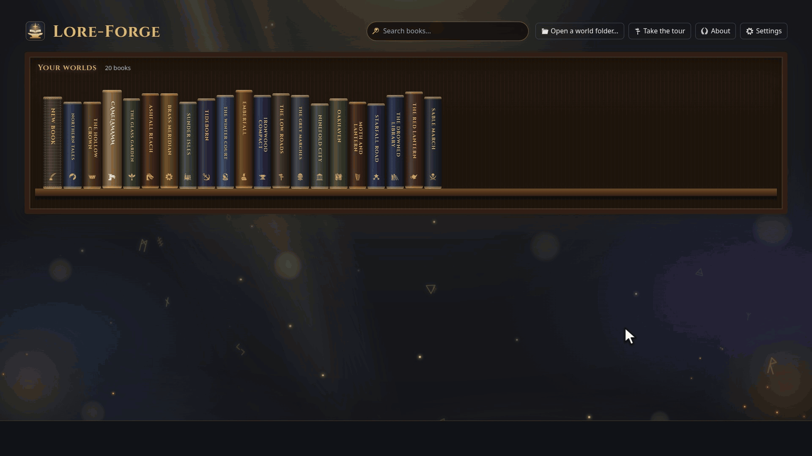
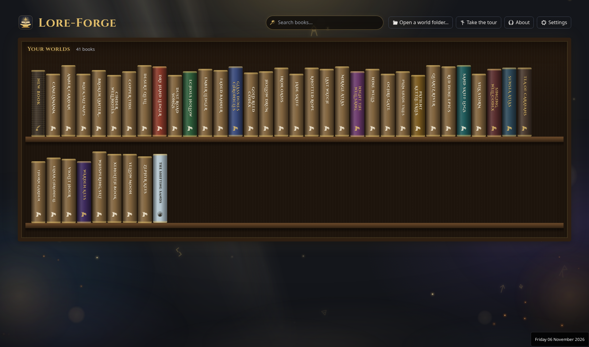
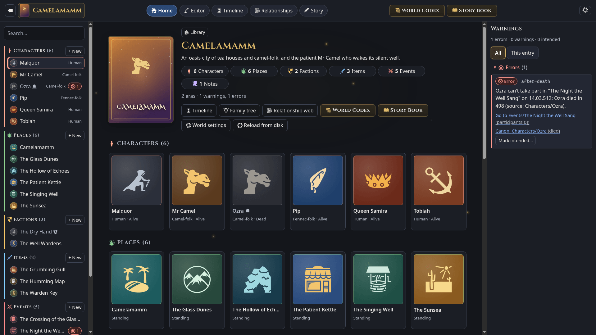
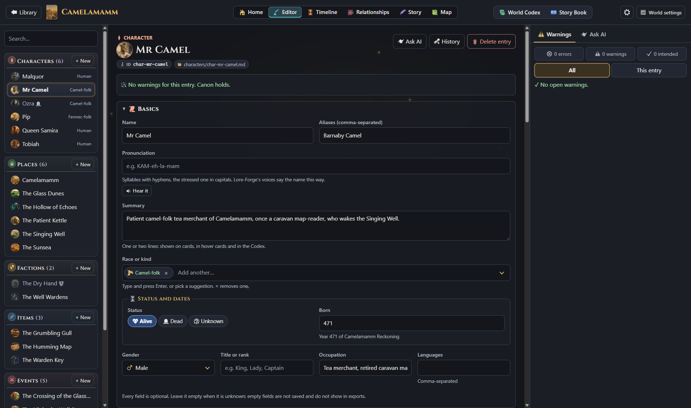
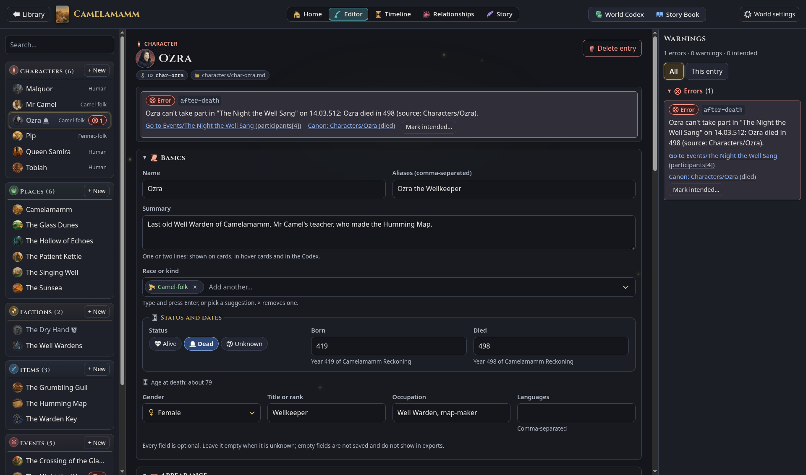
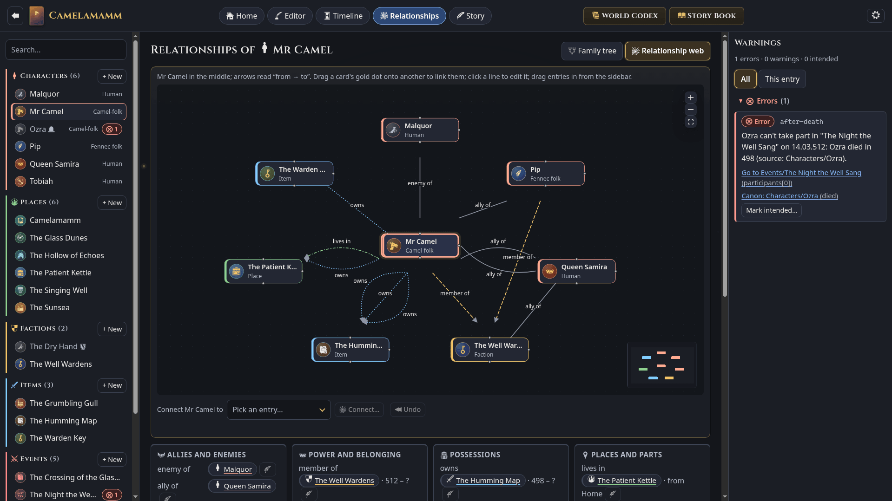
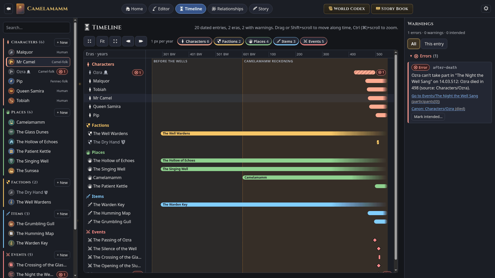
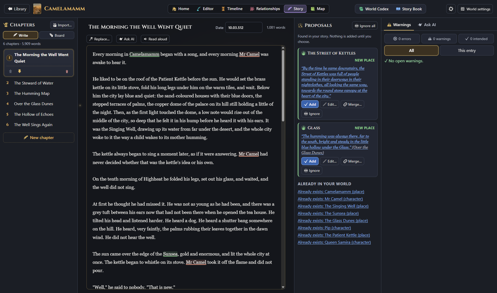
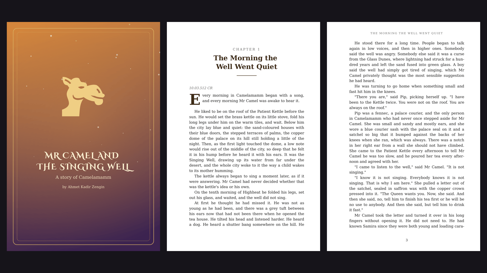

<div align="center">


# Lore-Forge

**Write your game worlds. Catch the contradictions.**

A free, offline desktop app for the worlds, lore, characters and stories of your games.
Every world is a plain folder of Markdown and YAML, checked live for contradictions, laid out on a LegendKeeper-style timeline, and exported as a World Codex and a print-ready Story Book (PDF, Word or Markdown).

[](https://github.com/kaharamamm/Lore-Forge/releases/latest)
[](https://github.com/kaharamamm/Lore-Forge/releases)
[](LICENSE)
[](#download)

[**Download**](#download) · [Features](#features) · [Write with AI](#write-with-an-ai-assistant) · [Quick start](#quick-start) · [User guide](docs/USER-GUIDE.md) · [World format](docs/FORMAT.md)



</div>

---

## Download

| System | Download | Install |
| --- | --- | --- |
| **Windows 10/11** (x64) | [`Lore-Forge-Setup-x64.exe`](https://github.com/kaharamamm/Lore-Forge/releases/latest/download/Lore-Forge-Setup-x64.exe) | Run the installer. |
| **macOS** (Apple Silicon) | [`Lore-Forge-mac-arm64.dmg`](https://github.com/kaharamamm/Lore-Forge/releases/latest/download/Lore-Forge-mac-arm64.dmg) | Open the disk image and drag Lore-Forge to Applications. |
| **macOS** (Intel) | [`Lore-Forge-mac-x64.dmg`](https://github.com/kaharamamm/Lore-Forge/releases/latest/download/Lore-Forge-mac-x64.dmg) | The same. |
| **Ubuntu, Debian** (x64) | [`Lore-Forge-amd64.deb`](https://github.com/kaharamamm/Lore-Forge/releases/latest/download/Lore-Forge-amd64.deb) | `sudo apt install ./Lore-Forge-amd64.deb` |
| **Other Linux** (x64) | [`Lore-Forge-x86_64.AppImage`](https://github.com/kaharamamm/Lore-Forge/releases/latest/download/Lore-Forge-x86_64.AppImage) | `chmod +x Lore-Forge-x86_64.AppImage`, then run it. |

These links always download the newest version, so they are safe to bookmark or share. No Node.js or build tools are needed.

### Updates

Lore-Forge checks for a new version when it starts and every few hours. A small notice in the corner offers **Download**, **Later** and **What's new**; when the download is done, **Restart to update** installs it and starts the new version. **About → Updates** shows your version, has **Check now**, and can turn the automatic check off.

- **Windows** and the **AppImage** update themselves.
- **.deb:** the system asks for your password once (the update is installed with `dpkg`), then Lore-Forge restarts.
- **macOS:** the builds are not signed, so macOS does not let the app replace itself. **Download** opens the new disk image; drag it to Applications as before.

Updating never touches your worlds: they live in your own folders (see [Your data](#your-data)), not in the program's folder.

### Opening an unsigned app

The builds are not code-signed (signing needs paid certificates), so the first start asks once:

- **Windows:** SmartScreen says *"Windows protected your PC"*. Choose **More info**, then **Run anyway**.
- **macOS:** *"Lore-Forge cannot be opened because Apple cannot check it"*. Open **System Settings → Privacy & Security**, scroll down and choose **Open Anyway** (or right-click the app in Applications and choose **Open**). If macOS says the app *"is damaged"*, run `xattr -dr com.apple.quarantine /Applications/Lore-Forge.app` once in Terminal.
- **Linux AppImage:** if it says *"AppImages require FUSE"*, install `libfuse2t64` (Ubuntu 24.04) or `libfuse2` (22.04). If it exits with *"GPU process isn't usable"*, start it with `--no-sandbox` or use the `.deb`.

---

## Why Lore-Forge

- **Canon you can trust.** Consistency rules run while you type: a character acting after their death, a parent born after their child, a city visited before it was founded. Each warning points at the exact field and the fact it breaks; **Go to** jumps there, **Mark intended** keeps a contradiction on purpose.
- **Your files, not a cloud.** A world is a folder of Markdown with YAML front matter. It works offline, lives happily in git, diffs cleanly and can be read by other tools. Nothing leaves your machine unless you connect an AI app or picture service yourself.
- **Works with your AI.** Ask Claude, Codex, Cursor or another MCP app for a story and it writes the whole book in Lore-Forge: entries, relationships, chapters and pictures, checked for contradictions.
- **Built for game worlds.** Custom calendars and eras, partial dates, a LegendKeeper-style timeline, family trees, relationship webs, art briefs and reference images for artists and 3D tools.
- **From notes to a book.** Write the story chapter by chapter; Lore-Forge proposes entries from your prose and exports a typeset Story Book (PDF, Word or Markdown), with A4 among the trim sizes and Word matching the PDF including the cover.

## Features

<table>
  <tr>
    <td width="50%" valign="top"><br><b>Library.</b> Worlds as books on shelves. Drag freely to rearrange; <b>New book</b> stays first on the top shelf. Duplicate keeps the cover colours and stays on the shelf.</td>
    <td width="50%" valign="top"><br><b>World home.</b> Cover, counts and a card for every entry. An amber warnings chip appears only when something is open.</td>
  </tr>
  <tr>
    <td width="50%" valign="top"><br><b>Editor.</b> Structured fields per type, dates on your own calendar, linked names. A circular entry image sits in the title when one is set.</td>
    <td width="50%" valign="top"><br><b>Consistency warnings.</b> Live, with <i>Go to</i> and <i>Mark intended</i>. No empty “no warnings” noise on the chips.</td>
  </tr>
  <tr>
    <td width="50%" valign="top"><br><b>Relationship web and family tree.</b> Drag to link entries.</td>
    <td width="50%" valign="top"><br><b>Timeline.</b> LegendKeeper-style Gantt on d3: era bands, swimlanes, icon+title bars, image cards, an overview strip, and a Lanes | Stacked toggle.</td>
  </tr>
  <tr>
    <td width="50%" valign="top"><br><b>Story.</b> A chapter-by-chapter manuscript that proposes entries from your text.</td>
    <td width="50%" valign="top"><br><b>Story Book and World Codex.</b> PDF, Word and Markdown. A4 among the sizes; copyright page and drop-cap options; Word matches the PDF, cover included.</td>
  </tr>
</table>

The warning in these screenshots was added on purpose to a copy of the sample world; the sample world itself has none.

More in the [user guide](docs/USER-GUIDE.md).

## Write with an AI assistant

Lore-Forge works with AI apps that support MCP: Claude Desktop, Claude Code, Codex, Cursor and others. Choose **Connect AI** in the library, connect your app once, then ask it something like *"Write me a story about camels in Lore-Forge"*.

The assistant creates a new book on your shelf. It adds characters, places, factions, items and events with their dates and details, the relationships between them and the chapters. Then it runs the consistency checks and fixes what they find. If Lore-Forge is open, you watch the book fill in; afterwards it is an ordinary book that you keep editing. It can also continue or change a book you already have.

Pictures for the entries and the cover use your own key for OpenAI, Google Gemini or xAI Grok, set in **Connect AI → Pictures**. The key stays on your computer. Setup, tools and privacy: [docs/MCP.md](docs/MCP.md).

## Quick start

1. [Download](#download) and install Lore-Forge, then start it.
2. The library opens with the sample world **Camelamamm**: a six-chapter story about Mr Camel and the Singing Well, with 23 entries and pictures. On the first start a short tour walks you through it (**Take the tour** in the library brings it back). The installed sample is read-only: **Duplicate** puts an editable copy on the shelf next to it (same cover colours; it does not open by itself).
3. Click **New book** (always first on the top shelf), give your world a name, colour and emblem.
4. In the sidebar, choose **+ New** next to *Characters*, type a name and a birth date. The entry is saved as `characters/<id>.md` a moment after you stop typing.
5. Set their status to *Dead* with a death date before the birth date, and watch the warnings panel flag it (`date-order`).
6. To have an AI assistant write a book, choose **Connect AI** in the library (see [Write with an AI assistant](#write-with-an-ai-assistant)).

## Your data

A world is a folder you own:

```text
my-world/
  world.json                   name, calendar, rules, book details, cover
  characters/char-*.md         one Markdown file per entry, by type
  places/  factions/  items/  events/  notes/
  story/01-the-first-chapter.md   story chapters
  images/<entry-id>/<view>.png    reference images
  models/<entry-id>/<name>.glb    3D models (.glb, .gltf, .obj, .fbx)
```

```markdown
---
id: char-mr-camel
type: character
name: Mr Camel
race: camel-folk
born: "471"
status: alive
relations:
  - type: owns
    target: item-humming-map
---

Mr Camel keeps the smallest tea house on the Street of Kettles…
```

New worlds are saved in the app's own data folder (`~/.config/Lore-Forge/worlds` on Linux, `%APPDATA%\Lore-Forge\worlds` on Windows, `~/Library/Application Support/Lore-Forge/worlds` on macOS) unless you pick another folder in **Library settings**. Installing, updating or removing the app leaves them alone.

Edit the files with any text editor, keep them in git, or read them from your own tools. Fields Lore-Forge doesn't know are kept. Details: [World format, dates and rules](docs/FORMAT.md) and [Integration guide](docs/INTEGRATION.md).

## Command line

The installed app includes the `lore` command-line tool. It checks and exports worlds without a window, for scripts and CI, and needs nothing else installed:

```bash
lore check ~/my-world                  # exit 1 when there are errors
lore codex ~/my-world -o codex.pdf     # World Codex PDF
lore book ~/my-world -o book.pdf       # Story Book PDF (or .docx)
lore duplicate ~/my-world "My copy"    # a copy with a new id, next to the original
lore mcp                               # the MCP server AI apps start (see docs/MCP.md)
```

| System | Where `lore` is |
| --- | --- |
| **Windows** | `lore.cmd` in `resources\bin` of the install folder (by default `%LOCALAPPDATA%\Programs\Lore-Forge\resources\bin`). Add that folder to your `PATH` to type `lore` anywhere. |
| **macOS** | `/Applications/Lore-Forge.app/Contents/Resources/bin/lore`. To type `lore` anywhere: `sudo ln -s /Applications/Lore-Forge.app/Contents/Resources/bin/lore /usr/local/bin/lore` |
| **.deb** | `/usr/bin/lore`, ready to use. |
| **AppImage** | Inside the image; use the `.deb`, or run it from a source checkout. |
| **Source checkout** | `npm run lore -- check worlds/camelamamm` |

See [docs/CLI.md](docs/CLI.md).

## Build from source

You need Node.js 22.18 or newer (Node 24 recommended) and git.

```bash
git clone https://github.com/kaharamamm/Lore-Forge.git
cd Lore-Forge
npm install
npm run dev        # build and start the desktop app
npm test
```

Architecture, tests, packaging and releases: [docs/DEVELOPMENT.md](docs/DEVELOPMENT.md).

## Roadmap

- Ideas and requests are welcome in [issues](https://github.com/kaharamamm/Lore-Forge/issues).

## Contributing

Bug reports, feature ideas and pull requests are welcome. Read [CONTRIBUTING.md](CONTRIBUTING.md) first; this project follows the [Code of Conduct](CODE_OF_CONDUCT.md). Security issues: see [SECURITY.md](SECURITY.md). Changes are listed in [CHANGELOG.md](CHANGELOG.md).

## Licence and credits

Lore-Forge is released under the [MIT License](LICENSE). Copyright (c) 2026 Ahmet Kadir Zengin. Worlds you create are yours; the licence covers Lore-Forge itself, not what you write with it. The sample world Camelamamm is under the same licence as the repository.

- Icons: [game-icons.net](https://game-icons.net) by Lorc, Delapouite and contributors, CC BY 3.0. Used unchanged except for colour and size.
- Heading font: Cinzel by Natanael Gama and the Cinzel Project Authors, SIL Open Font License 1.1.
- Cover fonts: the Fontsource packages listed in `packages/pdf/package.json` and Liberation Sans and Serif, SIL Open Font License 1.1.
- PDF fonts: DejaVu Sans, Serif and Mono, Bitstream Vera / DejaVu licence.
- React Flow (MIT), d3 (ISC), Preact (MIT), PDFKit (MIT), auto-animate (MIT), three.js (MIT, the 3D model viewer), electron-updater (MIT), the MCP TypeScript SDK and zod (MIT, the server for AI apps).

The app lists the same credits under **About** in the library.
